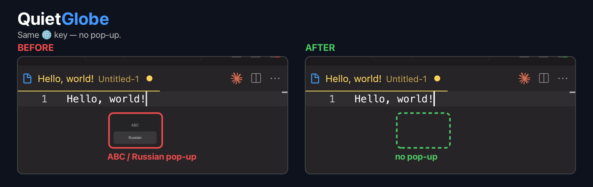
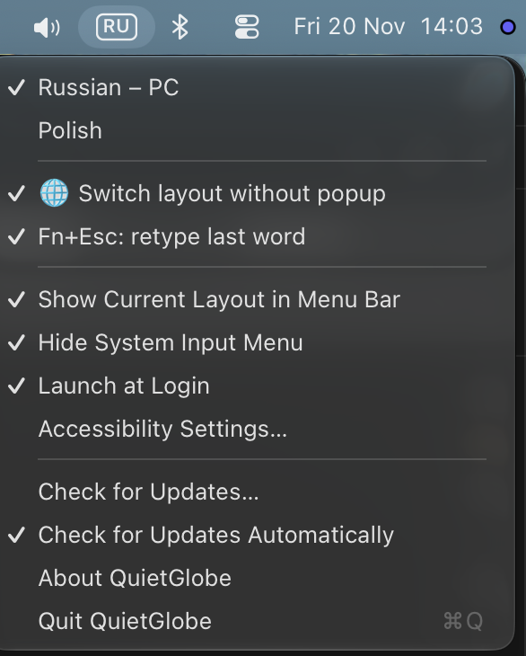

# QuietGlobe

**A small keyboard-layout companion for macOS: switch layouts with the 🌐 Globe key without the popup, fix a word typed in the wrong layout with Fn+Esc, and see the current layout in the menu bar.**

**English** · [Русский](README.ru.md) · [Install](#install) · [Usage](#usage) · [Troubleshooting](#troubleshooting) · [FAQ](#faq)

[](https://www.apple.com/macos/)
[](#supported-macos)
[](https://swift.org)
[](LICENSE)
[](https://github.com/prakunin/quietglobe/releases/latest)

## What it does

### 🌐 Switch layouts without the popup

Pressing 🌐 (Globe/Fn) on macOS shows a floating **input source indicator** (the “ABC / Russian” popup) that covers your text and stays until you type. It appears for every enabled layout — ABC ↔ Russian, ABC ↔ German, any pair. QuietGlobe switches the layout itself, instantly, and the popup never appears. Same key, no HUD, no delay.



### ⌨️ Fn+Esc: retype in the other layout

Typed `ghbdtn` while the Latin layout was active? Press **Fn+Esc** and it becomes `привет`, and the layout switches. Keep holding Fn and press Esc again to convert one more word.

### 🔤 Current layout in the menu bar

The menu bar icon shows the active layout — `RU`, `A`, `PL`… — and updates on any switch, like the system input menu. Click it to pick a layout. You can hide the system indicator so only one icon stays.


Free and open source. Native Swift, public macOS APIs only, no telemetry.

## Install

### Homebrew

```bash
brew tap prakunin/tap
brew trust prakunin/tap   # Homebrew 7+: third-party taps must be trusted
brew install --cask quietglobe
```

### One-line installer

```bash
curl -fsSL https://raw.githubusercontent.com/prakunin/quietglobe/main/install.sh | bash
```

Downloads the latest release, verifies its SHA-256 checksum, installs to `/Applications` (or `~/Applications`) and opens QuietGlobe. Options: `VERSION=1.3.0` pins a version, `FROM_SOURCE=1` builds from source (needs Xcode Command Line Tools).

### Manual

Download `QuietGlobe.zip` from [Releases](https://github.com/prakunin/quietglobe/releases/latest) and move `QuietGlobe.app` to `/Applications`.

> QuietGlobe is signed with a self-signed certificate and is not notarized by Apple. A zip downloaded in a browser gets quarantined and Gatekeeper may refuse to open it; Homebrew and the installer avoid that. For a manual download, run `xattr -dr com.apple.quarantine /Applications/QuietGlobe.app` once.

## First launch

1. Open **QuietGlobe**. It lives in the menu bar (no Dock icon) and places itself next to the clock.
2. macOS asks for **Accessibility** permission: QuietGlobe needs it to see the 🌐 key before the system does. Enable **QuietGlobe** in **System Settings → Privacy & Security → Accessibility**.
3. QuietGlobe notices the permission within a second and starts. No restart needed.
4. Make sure 🌐 is set to **“Change Input Source”** in **System Settings → Keyboard** (it is by default).

## Usage

### Globe key

- Press and release **🌐** to switch to the previous layout.
- The switch happens on **release**, and only if no other key was pressed meanwhile, so 🌐 still works as a modifier (Fn+Esc, Fn+arrows…).

### Fn+Esc

- **Fn+Esc** deletes the last word and retypes the same keys in the other layout; the layout switches too. Trailing spaces are kept.
- **Series:** keep holding **Fn** and press **Esc** again to add the previous word (2 words, then 3…). Releasing Fn ends the series. Press Fn+Esc again afterwards to convert back.
- QuietGlobe remembers **key codes, not characters**, so Shift and Option combinations (e.g. Polish ą, ę) come out right in the target layout.
- The remembered line resets on Return, Tab, arrows, Home/End/PgUp/PgDn, Cmd/Ctrl shortcuts, mouse clicks and app switches. Nothing is recorded in password fields (secure input).
- Fn+Esc beeps when there is nothing to convert.
- Works anywhere you can type, Terminal included (it sends Backspace + key presses). Not supported yet: Caps Lock (retyped in lower case), dead keys and IMEs, lines longer than 256 keys.

### Menu

Click the layout icon:



| Item | What it does |
|---|---|
| *Your layouts* | Switch to a layout; ✓ marks the active one. |
| **🌐 Switch layout without popup** | Globe interception. Off: macOS handles 🌐 itself, popup included. |
| **Fn+Esc: retype last word** | The retype hotkey. Independent of the Globe toggle. |
| **Show Current Layout in Menu Bar** | On by default. Off: a 🌐 globe icon instead. |
| **Hide System Input Menu** | Hides the system layout indicator (same as *System Settings → Keyboard → Text Input → Edit… → Show Input menu in menu bar*). |
| **Launch at Login** | Start QuietGlobe when you log in. |
| **Accessibility Settings…** / **Grant Accessibility…** | Open the permission pane, or ask for the permission again (see [Troubleshooting](#troubleshooting)). |
| **Check for Updates…** / **Check for Updates Automatically** | Update now, or turn the daily check on/off. |

The icon is dimmed when both features are off, and shows ⚠️ when the Accessibility permission is missing. ⌘-drag it to move it; macOS remembers the place.

## Updates

QuietGlobe checks for updates once a day with [Sparkle](https://sparkle-project.org) (or use **Check for Updates…**). Updates are signed (EdDSA) and installed in place. Every release is signed with the same certificate, so the Accessibility permission survives updates. Homebrew users can also run `brew upgrade --greedy`.

## Troubleshooting

**The icon shows ⚠️.** QuietGlobe has no Accessibility permission. Click it → **Grant Accessibility…**. QuietGlobe resets its permission entry and relaunches, and macOS asks again. Then enable QuietGlobe in the list.

**QuietGlobe is missing from the Accessibility list.** This happens after it was removed with “−”: macOS does not add it back on its own. **Grant Accessibility…** fixes it.

**I removed the permission while QuietGlobe was running.** Input may pause for about two seconds: QuietGlobe notices that keys and clicks stop reaching the system, removes its keyboard hook and shows ⚠️. Grant the permission again to bring it back.

**The popup still appears.** Check that **🌐 Switch layout without popup** is on and that 🌐 is set to “Change Input Source” in System Settings → Keyboard. Other shortcuts (Ctrl+Space, Caps Lock) still show the system popup — QuietGlobe handles the Globe key only.

**I built it from source and the permission keeps resetting.** macOS ties the permission to the code signature, and ad-hoc builds get a new one on every build. Sign with a stable identity, see [CONTRIBUTING.md](CONTRIBUTING.md#development).

## Supported macOS

| macOS | Status |
|---|---|
| 13 Ventura, 14 Sonoma, 15 Sequoia | Supported |
| 26, 27 | Supported (tested on 27.2) |

Universal 2 build for Apple Silicon and Intel. The Globe key is on Apple keyboards and modern MacBooks.

## FAQ

### How do I disable the ABC/Russian popup on macOS?

There is no macOS setting for it. Install QuietGlobe, grant Accessibility and keep 🌐 set to “Change Input Source”: QuietGlobe switches the layout itself, so the indicator never shows. Works for any enabled layout, not only ABC/Russian.

### Does it work with Caps Lock or Ctrl+Space?

Not yet: QuietGlobe handles the 🌐 Globe key. Other ways of switching keep working, with the system popup.

### Why does it need Accessibility permission?

To see the Globe key before the system shows its popup, and to retype words for Fn+Esc. macOS requires Accessibility for any app that intercepts or sends keyboard events.

### Does it collect data?

No. No analytics, no telemetry, and nothing you type leaves your Mac or touches the disk. The only network request is the daily update check (see [Privacy](#privacy)).

### How do I uninstall it?

Quit QuietGlobe, then `brew uninstall --cask quietglobe` (Homebrew) or delete `/Applications/QuietGlobe.app`. Remove it from **System Settings → Privacy & Security → Accessibility**. If you used **Hide System Input Menu**, turn the system indicator back on in System Settings → Keyboard → Text Input first, or run `defaults write com.apple.TextInputMenu visible -bool true`.

## Privacy

- **Network:** only the daily update check — a download of `appcast.xml` from GitHub. Nothing about you or your typing is sent.
- **Typing:** for Fn+Esc, the key codes of the current line are kept in memory only. They are never logged or written to disk, and are dropped on Return, clicks, app switches and in password fields.
- **Logs:** QuietGlobe logs to the system log (`/usr/bin/log show --predicate 'subsystem == "io.github.prakunin.quietglobe"'`): layout ids and counts, never typed text.
- No analytics or telemetry. The source is open for review.

## How it works

- A [`CGEventTap`](https://developer.apple.com/documentation/coregraphics/cgevent/tapcreate(tap:place:options:eventsofinterest:callback:userinfo:)) sees key events before the system. QuietGlobe consumes the Globe key, so the popup is never triggered, and switches the layout with the Text Input Sources API (`TISSelectInputSource`). Every other event passes through unchanged.
- Fn+Esc replays the remembered key codes as synthetic Backspace + key events after switching the layout.
- The menu bar badge follows `kTISNotifySelectedKeyboardInputSourceChanged`, so it is right whichever way the layout changed.
- If keys and clicks stop reaching the system while the hook is installed (for example, the permission was removed while running), QuietGlobe removes the hook within about two seconds instead of leaving input frozen.

Public APIs only: no private frameworks, no kernel extensions.

## Build from source

Requirements: macOS 13+, Xcode Command Line Tools with Swift 6.

```bash
git clone https://github.com/prakunin/quietglobe.git
cd quietglobe
./scripts/test.sh
./scripts/build.sh
open QuietGlobe.app
```

SwiftPM fetches the pinned Sparkle automatically; build products go outside the repo (`QG_SCRATCH`, default `$TMPDIR/quietglobe-spm`). See [CONTRIBUTING.md](CONTRIBUTING.md) for signing and the project layout.

## Feedback and contributing

- Bugs, ideas and questions: [GitHub Issues](https://github.com/prakunin/quietglobe/issues).
- Security issues: privately, see [SECURITY.md](SECURITY.md).
- Pull requests are welcome, see [CONTRIBUTING.md](CONTRIBUTING.md). If QuietGlobe helps you, a star helps others find it.

## License

MIT © Vasili Prakunin. See [LICENSE](LICENSE).
