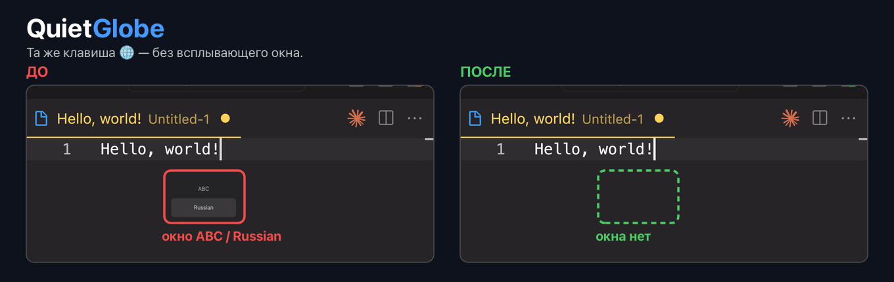
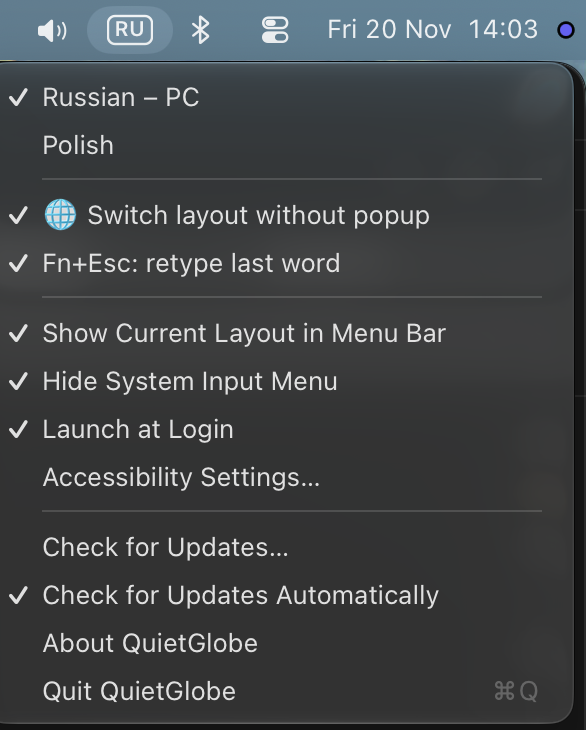

# QuietGlobe

**Небольшой помощник для раскладок на macOS: переключение клавишей 🌐 без всплывающего окна, исправление слова, набранного не в той раскладке, по Fn+Esc, и текущая раскладка в строке меню.**

[English](README.md) · **Русский** · [Установка](#установка) · [Использование](#использование) · [Если что-то не так](#если-что-то-не-так) · [FAQ](#faq)

[](https://www.apple.com/macos/)
[](#поддерживаемые-версии-macos)
[](https://swift.org)
[](LICENSE)
[](https://github.com/prakunin/quietglobe/releases/latest)

## Что умеет

### 🌐 Переключение раскладки без всплывающего окна

При нажатии 🌐 (Globe/Fn) macOS показывает **индикатор источника ввода** — окно «ABC / Russian», которое закрывает текст и висит, пока не начнёшь печатать. Оно появляется для любой пары раскладок: ABC ↔ Russian, ABC ↔ German и т. д. QuietGlobe переключает раскладку сам и мгновенно, окно не появляется. Та же клавиша, без HUD и без задержки.



### ⌨️ Fn+Esc: перенабрать в другой раскладке

Набрали `ghbdtn` в латинской раскладке? Нажмите **Fn+Esc** — получится `привет`, и раскладка переключится. Не отпуская Fn, нажмите Esc ещё раз — исправится ещё одно слово.

### 🔤 Текущая раскладка в строке меню

Значок в строке меню показывает активную раскладку — `RU`, `A`, `PL`… — и обновляется при любом переключении, как системное меню ввода. По клику можно выбрать раскладку. Системный индикатор можно скрыть, чтобы остался один значок.


Бесплатно и с открытым кодом. Нативный Swift, только публичные API macOS, без телеметрии.

## Установка

### Homebrew

```bash
brew tap prakunin/tap
brew trust prakunin/tap   # Homebrew 7+: сторонним tap нужно доверие
brew install --cask quietglobe
```

### Установщик одной командой

```bash
curl -fsSL https://raw.githubusercontent.com/prakunin/quietglobe/main/install.sh | bash
```

Скачивает последний релиз, проверяет SHA-256, ставит в `/Applications` (или `~/Applications`) и запускает QuietGlobe. Параметры: `VERSION=1.3.0` — конкретная версия, `FROM_SOURCE=1` — сборка из исходников (нужны Xcode Command Line Tools).

### Вручную

Скачайте `QuietGlobe.zip` со страницы [Releases](https://github.com/prakunin/quietglobe/releases/latest) и перенесите `QuietGlobe.app` в `/Applications`.

> QuietGlobe подписан самоподписанным сертификатом и не нотаризован Apple. Zip, скачанный в браузере, попадает в карантин, и Gatekeeper может не дать его открыть; Homebrew и установщик это обходят. После ручного скачивания один раз выполните `xattr -dr com.apple.quarantine /Applications/QuietGlobe.app`.

## Первый запуск

1. Откройте **QuietGlobe**. Он живёт в строке меню (без значка в Dock) и сам встаёт рядом с часами.
2. macOS попросит разрешение **Accessibility**: QuietGlobe должен увидеть клавишу 🌐 раньше системы. Включите **QuietGlobe** в **System Settings → Privacy & Security → Accessibility**.
3. QuietGlobe заметит разрешение в течение секунды и заработает. Перезапуск не нужен.
4. Убедитесь, что 🌐 настроена как **«Change Input Source»** в **System Settings → Keyboard** (так по умолчанию).

## Использование

### Клавиша 🌐

- Нажмите и отпустите **🌐** — включится предыдущая раскладка.
- Переключение происходит при **отпускании** и только если, пока клавиша была зажата, не нажимали другую, — поэтому 🌐 по-прежнему работает как модификатор (Fn+Esc, Fn+стрелки…).

### Fn+Esc

- **Fn+Esc** удаляет последнее слово и набирает те же клавиши в другой раскладке; раскладка тоже переключается. Пробелы в конце сохраняются.
- **Серия:** не отпуская **Fn**, нажмите **Esc** ещё раз — добавится предыдущее слово (2 слова, потом 3…). Отпустили Fn — серия закончилась. Повторное Fn+Esc после этого вернёт как было.
- QuietGlobe запоминает **коды клавиш, а не символы**, поэтому сочетания с Shift и Option (например, польские ą, ę) правильно воспроизводятся в целевой раскладке.
- Запомненная строка сбрасывается на Return, Tab, стрелках, Home/End/PgUp/PgDn, сочетаниях с Cmd/Ctrl, кликах мышью и смене приложения. В полях паролей (secure input) ничего не запоминается.
- Если переводить нечего, Fn+Esc пищит.
- Работает везде, где можно печатать, включая Terminal (отправляет Backspace + нажатия клавиш). Пока не поддерживается: Caps Lock (перенабирается строчными), мёртвые клавиши и IME, строки длиннее 256 клавиш.

### Меню

Клик по значку раскладки:



| Пункт | Что делает |
|---|---|
| *Ваши раскладки* | Переключиться на раскладку; ✓ — активная. |
| **🌐 Switch layout without popup** | Перехват 🌐. Выключено — 🌐 обрабатывает сам macOS, со своим окном. |
| **Fn+Esc: retype last word** | Горячая клавиша перенабора. Не зависит от переключателя 🌐. |
| **Show Current Layout in Menu Bar** | По умолчанию включено. Выключено — вместо раскладки глобус 🌐. |
| **Hide System Input Menu** | Скрывает системный индикатор раскладки (то же, что *System Settings → Keyboard → Text Input → Edit… → Show Input menu in menu bar*). |
| **Launch at Login** | Запускать QuietGlobe при входе в систему. |
| **Accessibility Settings…** / **Grant Accessibility…** | Открыть настройки разрешения или запросить его заново (см. [Если что-то не так](#если-что-то-не-так)). |
| **Check for Updates…** / **Check for Updates Automatically** | Обновиться сейчас или включить/выключить ежедневную проверку. |

Значок полупрозрачный, когда обе функции выключены, и показывает ⚠️, когда нет разрешения Accessibility. Перетащите его с ⌘, чтобы переставить, — macOS запомнит место.

## Обновления

QuietGlobe раз в сутки проверяет обновления через [Sparkle](https://sparkle-project.org) (или вручную — **Check for Updates…**). Обновления подписаны (EdDSA) и ставятся на месте. Все релизы подписаны одним сертификатом, поэтому разрешение Accessibility после обновления сохраняется. В Homebrew также работает `brew upgrade --greedy`.

## Если что-то не так

**На значке ⚠️.** У QuietGlobe нет разрешения Accessibility. Кликните по значку → **Grant Accessibility…**: QuietGlobe сбросит свою запись о разрешении и перезапустится, macOS спросит заново. Затем включите QuietGlobe в списке.

**QuietGlobe нет в списке Accessibility.** Так бывает после удаления кнопкой «−»: сама macOS его обратно не добавляет. Поможет **Grant Accessibility…**.

**Я убрал разрешение, пока QuietGlobe работал.** Ввод может замереть примерно на две секунды: QuietGlobe замечает, что нажатия и клики перестали доходить до системы, снимает свой перехват клавиатуры и показывает ⚠️. Выдайте разрешение снова, чтобы всё вернулось.

**Окно всё равно появляется.** Проверьте, что **🌐 Switch layout without popup** включён, а 🌐 настроена как «Change Input Source» в System Settings → Keyboard. Другие способы (Ctrl+Space, Caps Lock) по-прежнему показывают системное окно — QuietGlobe работает только с клавишей 🌐.

**Собрал из исходников, и разрешение всё время слетает.** macOS привязывает разрешение к подписи, а ad-hoc-сборки получают новую подпись при каждой сборке. Подписывайте постоянным сертификатом — см. [CONTRIBUTING.md](CONTRIBUTING.md#development).

## Поддерживаемые версии macOS

| macOS | Статус |
|---|---|
| 13 Ventura, 14 Sonoma, 15 Sequoia | Поддерживается |
| 26, 27 | Поддерживается (проверено на 27.2) |

Сборка Universal 2 для Apple Silicon и Intel. Клавиша 🌐 есть на клавиатурах Apple и современных MacBook.

## FAQ

### Как убрать окно ABC/Russian в macOS?

Настройки для этого в macOS нет. Установите QuietGlobe, выдайте Accessibility и оставьте 🌐 в режиме «Change Input Source»: QuietGlobe переключает раскладку сам, и индикатор не появляется. Работает для любой включённой раскладки, не только ABC/Russian.

### Работает ли с Caps Lock или Ctrl+Space?

Пока нет: QuietGlobe работает с клавишей 🌐. Остальные способы переключения работают как раньше — с системным окном.

### Зачем нужно разрешение Accessibility?

Чтобы увидеть клавишу 🌐 раньше, чем система покажет окно, и чтобы перенабирать слова по Fn+Esc. macOS требует Accessibility от любого приложения, которое перехватывает или отправляет нажатия клавиш.

### Собирает ли QuietGlobe данные?

Нет. Ни аналитики, ни телеметрии; ничего из набранного не покидает Mac и не пишется на диск. Единственный сетевой запрос — ежедневная проверка обновлений (см. [Конфиденциальность](#конфиденциальность)).

### Как удалить?

Закройте QuietGlobe, затем `brew uninstall --cask quietglobe` (Homebrew) или удалите `/Applications/QuietGlobe.app`. Уберите его из **System Settings → Privacy & Security → Accessibility**. Если включали **Hide System Input Menu**, сначала верните системный индикатор в System Settings → Keyboard → Text Input или выполните `defaults write com.apple.TextInputMenu visible -bool true`.

## Конфиденциальность

- **Сеть:** только ежедневная проверка обновлений — загрузка `appcast.xml` с GitHub. Ничего о вас и о набранном не отправляется.
- **Набор текста:** для Fn+Esc коды клавиш текущей строки хранятся только в памяти. Они не логируются и не пишутся на диск, а сбрасываются на Return, кликах, смене приложения и в полях паролей.
- **Логи:** QuietGlobe пишет в системный журнал (`/usr/bin/log show --predicate 'subsystem == "io.github.prakunin.quietglobe"'`): id раскладок и счётчики, но никогда не набранный текст.
- Без аналитики и телеметрии. Исходный код открыт для проверки.

## Как это работает

- [`CGEventTap`](https://developer.apple.com/documentation/coregraphics/cgevent/tapcreate(tap:place:options:eventsofinterest:callback:userinfo:)) видит нажатия раньше системы. QuietGlobe поглощает клавишу 🌐, поэтому окно не вызывается, и переключает раскладку через Text Input Sources API (`TISSelectInputSource`). Все остальные события проходят без изменений.
- Fn+Esc переключает раскладку и воспроизводит запомненные коды клавиш синтетическими Backspace и нажатиями.
- Значок в строке меню следит за `kTISNotifySelectedKeyboardInputSourceChanged`, поэтому он верен, как бы ни сменилась раскладка.
- Если при установленном перехвате нажатия и клики перестают доходить до системы (например, разрешение отозвали на ходу), QuietGlobe снимает перехват примерно за две секунды, а не оставляет ввод замёрзшим.

Только публичные API: без приватных фреймворков и расширений ядра.

## Сборка из исходников

Нужны macOS 13+ и Xcode Command Line Tools со Swift 6.

```bash
git clone https://github.com/prakunin/quietglobe.git
cd quietglobe
./scripts/test.sh
./scripts/build.sh
open QuietGlobe.app
```

SwiftPM сам скачает закреплённую версию Sparkle; продукты сборки лежат вне репозитория (`QG_SCRATCH`, по умолчанию `$TMPDIR/quietglobe-spm`). Про подпись и структуру проекта — в [CONTRIBUTING.md](CONTRIBUTING.md).

## Обратная связь и участие

- Ошибки, идеи и вопросы: [GitHub Issues](https://github.com/prakunin/quietglobe/issues).
- Проблемы безопасности — приватно, см. [SECURITY.md](SECURITY.md).
- Pull request'ы приветствуются, см. [CONTRIBUTING.md](CONTRIBUTING.md). Если QuietGlobe вам пригодился, звезда поможет другим его найти.

## Лицензия

MIT © Vasili Prakunin. См. [LICENSE](LICENSE).
